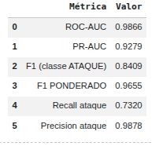
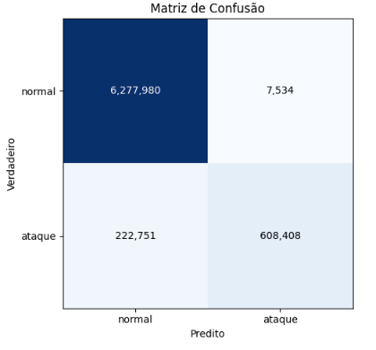
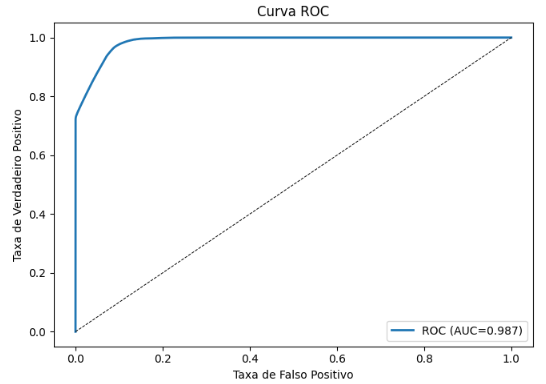

# Relatório de Experimento — Reprodução do IDS XGBoost para SOME/IP (Kim et al., 2026)

**Trabalho original:** T. Kim, H. Park, I. You, B. I. Kwak. *XGBoost-Based Anomaly Detection
Framework for SOME/IP in In-Vehicle Networks.* MDPI Systems, 14(2):196, 2026.
**Execução:** Google Colab (junho/2026). XGBoost roda em CPU; não requer GPU.
**Notebook:** [`Kim_Colab.ipynb`](../Kim_Colab.ipynb)

---

## 1. Contexto

Diferente dos demais trabalhos (baseados em aprendizado profundo), Kim et al. (2026) usam
**XGBoost** (*gradient boosting* de árvores). A tese central é evitar campos do **cabeçalho**
SOME/IP — que são identificadores específicos de implementação e causam *overfitting* — e usar
apenas **12 atributos comportamentais** (intervalo de tempo, verossimilhança/entropia do
*payload*, distância de Hamming e variação de tamanho), extraídos por pacote.

A tarefa é **binária** (normal vs. ataque), sobre um dataset **grande e realista** (~7,1 milhões
de pacotes; ~12% de ataque), gerado numa simulação vSomeIP com 9 ECUs. Os ataques cobrem
**DoS, Fuzzing e MITM**. As metas do artigo são **ROC-AUC 0,99 · PR-AUC 0,93 · F1 0,97**.

O dataset publica os **atributos já extraídos**; **não há código nem modelo treinado** — então
reproduzimos treinando o XGBoost com os hiperparâmetros da Tabela 2 do artigo.

---

## 2. Resultados

Configuração: XGBoost com 300 árvores (o artigo usa 1000), `scale_pos_weight` para rebalancear
a classe minoritária.

```
ROC-AUC: 0,9866  |  PR-AUC: 0,9279
F1 ponderado: 0,9655  |  F1 macro: 0,9114  |  Accuracy: 0,9676
F1 (classe ATAQUE): 0,8409  |  Precision: 0,9878  |  Recall: 0,7320
```

Matriz de confusão (linha = verdadeiro):
```
[6.277.980     7.534]   # normal
[  222.751   608.408]   # ataque  -> 222.751 ataques NÃO detectados (~27%)
```





| Métrica | Reprodução | Artigo |
|---|---:|---:|
| ROC-AUC | **0,987** | 0,99 |
| PR-AUC | **0,928** | 0,93 |
| F1 (ponderado) | **0,966** | 0,97 |

---

## 3. Interpretação

- **A capacidade discriminativa reproduz o artigo**: ROC-AUC (0,987) e PR-AUC (0,928) batem com
  os valores publicados (0,99 e 0,93). A curva ROC confirma o AUC ~0,99.
- **⚠️ O "F1 = 0,97" do artigo é o F1 PONDERADO** (média sobre as classes, **dominada pela
  classe normal**, que é ~88% dos dados). Nossa reprodução obtém **0,966 ponderado** — igual ao
  artigo. Porém, o **F1 da classe ATAQUE isoladamente é 0,84**, com **recall 0,73**: cerca de
  **27% dos ataques passam despercebidos** (222.751 falsos negativos na matriz).
- **Leitura de produção:** a métrica de destaque **mascara** o desempenho real de detecção. Com
  precisão altíssima (0,99 → pouquíssimos falsos alarmes) mas recall 0,73, o modelo é mais
  adequado como **filtro de primeira linha** numa defesa em profundidade do que como IDS
  autônomo. A fronteira da minoria — provavelmente ataques **MITM/injeção** com *payload* e
  *timing* válidos — é o gargalo; o **CTGAN** do artigo visa justamente reforçá-la (não usamos,
  pois não há código publicado).
- **Conclusão:** o trabalho é **reprodutível nas métricas globais**, mas a avaliação honesta de
  prontidão exige olhar o **recall da classe de ataque**, não o F1 ponderado.
